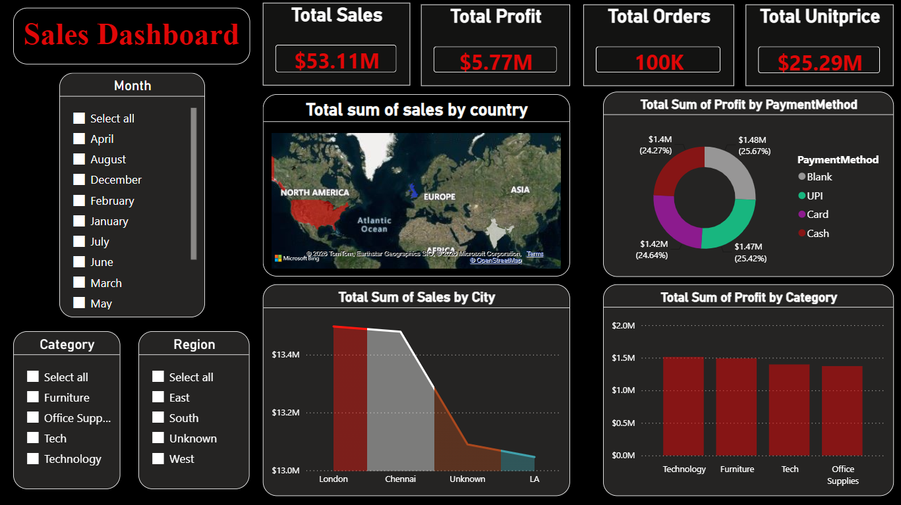

# 📊 Sales & Profit Analysis Dashboard | Power BI

## 📌 Project Overview
Developed my first interactive Power BI dashboard to analyze business sales and profitability across countries, cities, regions, payment methods, and product categories.

## 📈 Key Metrics
- **Total Sales:** $53.11M
- **Total Profit:** $5.77M
- **Total Orders:** 100K
- **Total Unit Price:** $25.29M

## 📊 Dashboard Highlights
- Sales by Country and City.
- Profit by Payment Method.
- Profit by Category.
- Monthly Sales Analysis.
- Region-wise Performance.
- Category-wise Filtering.
- Interactive Slicers and Visualizations.

## 🛠️ Tools & Skills Used
Power BI | DAX | Data Cleaning | Data Transformation | Data Analysis | Data Visualization | Dashboard Development

## 📸 Dashboard Preview

